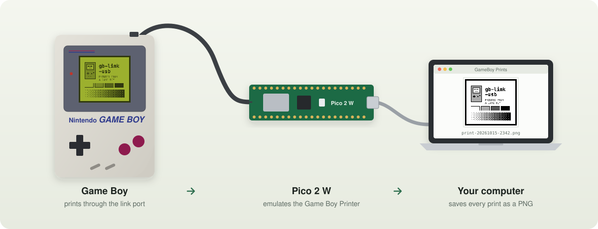
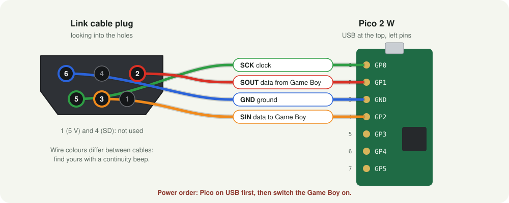
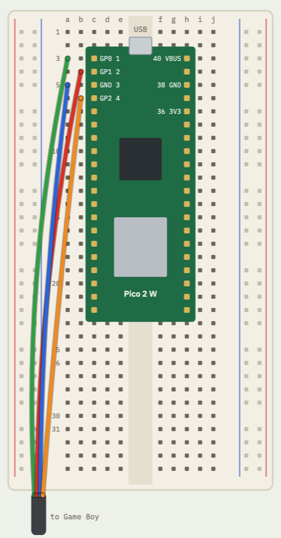
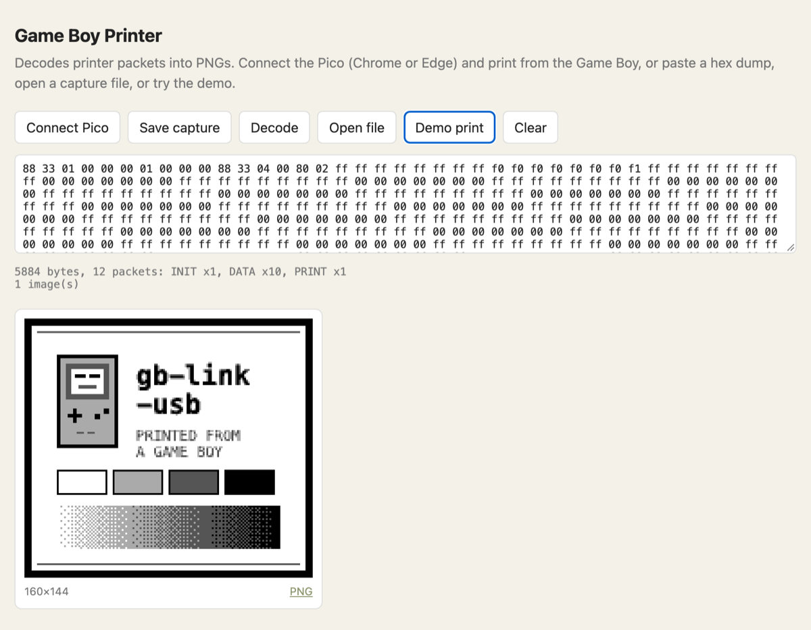
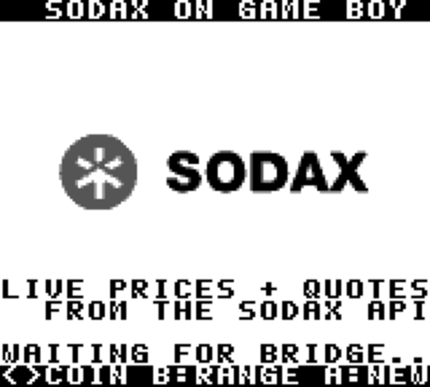
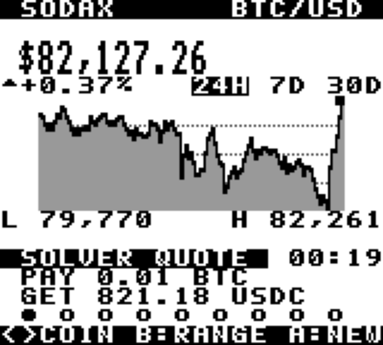
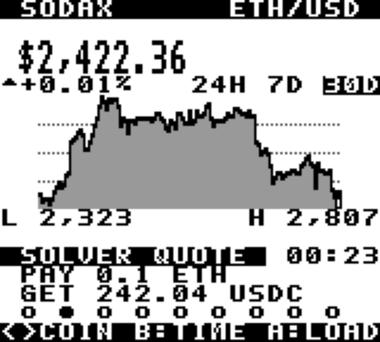
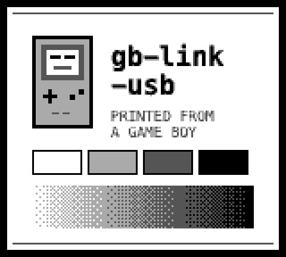

<p align="center">
  
</p>

<h1 align="center">gb-link-usb</h1>

<p align="center">
  <strong>Connect a Game Boy's link port to your computer over USB.</strong><br>
  Print from a real Game Boy straight to PNG, or watch live crypto prices from SODAX on it,<br>
  with a Raspberry Pi Pico 2 W and one cut link cable.
</p>

<p align="center">
  
  
  
  
  
  
  <a href="LICENSE"></a>
</p>

<p align="center">
  <a href="#quick-start">Quick start</a> ·
  <a href="#printing">Printing</a> ·
  <a href="#sodax-on-the-game-boy">SODAX</a> ·
  <a href="#troubleshooting">Troubleshooting</a> ·
  <a href="#how-it-works">How it works</a> ·
  <a href="#roadmap">Roadmap</a>
</p>

---

## Highlights

- **A Game Boy Printer that saves PNGs.** The Pico answers exactly like Nintendo's printer, so games print as usual, and every picture lands on your computer.
- **Live SODAX market data on the Game Boy.** Prices, charts and real swap quotes from the [SODAX](https://sodax.com) API, drawn by our own Game Boy ROM.
- **No level shifter, no soldering.** The Pico 2's RP2350 pins tolerate the Game Boy's 5 V signals, so four wires on a breadboard are enough.
- **Double-click to use.** On a Mac, one launcher saves every print to `Pictures/GameBoy Prints`, with a sound. Any computer with Chrome or Edge can use the web page instead.
- **Tested and documented.** The printer logic and the decoder have automated tests, and every hardware step, measurement and bug is written down in the [logbook](docs/LOGBOOK.md).

## What you need

| | Part | Notes |
|---|---|---|
| 1 | **Raspberry Pi Pico 2 W** (or 2 WH) | Must be a Pico **2**. An original Pico (RP2040) is not 5 V tolerant and needs a level shifter. |
| 2 | **Game Boy link cable** you can cut | Built and tested with a DMG-04. You keep one plug end. |
| 3 | Breadboard and jumper wires | Or solder the four wires straight to the Pico. |
| 4 | Multimeter with continuity beep | To find which wire is which: colours are not standard. |
| 5 | Mac with [Node.js](https://nodejs.org), or any computer with Chrome/Edge | For saving the prints. |

## Quick start

### 1. Map the cable

Cut the link cable, keep one plug with some cable attached, and strip the wire ends. With the multimeter in beep mode, put a paperclip in one plug hole and touch each wire until it beeps.

<p align="center">
  
</p>

| Plug pin | Signal | Pico pin |
|:---:|---|:---:|
| 5 | SCK, clock | **1** (GP0) |
| 2 | SOUT, data from the Game Boy | **2** (GP1) |
| 6 | GND | **3** (GND) |
| 3 | SIN, data to the Game Boy | **4** (GP2) |

Pins 1 (5 V) and 4 (SD) are usually not in the cable and are not needed. Leave the bare shield unconnected and taped.

### 2. Wire it to the Pico

<table>
  <tr>
    <td width="42%"></td>
    <td>
      <p>Press the Pico into the middle of the breadboard, USB end up. Each cable wire goes into a free hole in the same row as its Pico pin, on the left side of the gap.</p>
      <p>Nothing else is connected: no level shifter, no power wires.</p>
      <p>Hole-by-hole drawing: <a href="https://hazy2go.github.io/gb-link-usb/breadboard.html">interactive wiring page</a>.</p>
      <blockquote><strong>Power order matters.</strong> Plug the Pico into USB <em>before</em> switching the Game Boy on, and switch the Game Boy off <em>before</em> unplugging the Pico. The RP2350 tolerates 5 V on its pins only while it is powered.</blockquote>
    </td>
  </tr>
</table>

### 3. Flash the firmware

1. Get `gb_link_usb.uf2` from [Releases](../../releases), or [build it yourself](#development).
2. Hold the white **BOOTSEL** button on the Pico while plugging it into USB, then let go. A drive called **RP2350** appears.
3. Drag `gb_link_usb.uf2` onto the drive. The Pico restarts as a Game Boy Printer.

## Printing

### On a Mac: double-click

1. Download this repository (**Code → Download ZIP**) and unzip it.
2. Double-click **`GB Printer.command`**. The first time, macOS may block it: right-click it → **Open** → **Open**.
3. Wait for `Pico connected`, then print from the game.

Every print is saved in **Pictures → GameBoy Prints**, at original size and at 4×, with a sound. Unplugging and replugging the Pico is fine. Leave the window open while you print.

### Any computer: the web page

Open **<https://hazy2go.github.io/gb-link-usb/>** in Chrome or Edge, click **Connect Pico**, and print. Prints appear on the page with a PNG download link. Nothing to install.

<sub>To run it locally instead: `cd web && python3 -m http.server 8000`, then open http://localhost:8000.</sub>

<p align="center">
  
</p>

## SODAX on the Game Boy

<p align="center">
  
  
  
</p>
<p align="center"><sub>Emulator screenshots with live data. Tested on a real DMG.</sub></p>

Live prices, a 24H / 7D / 30D chart and a **real swap quote from the SODAX solver** for 9 coins (BTC, ETH, SOL, SODA, SUI, HYPE, AVAX, XLM, POL), on an original Game Boy.

1. Put `sodax.gb` (from [Releases](../../releases)) on a flash cart such as an EverDrive.
2. With the Pico on USB, double-click **`SODAX Bridge.command`** (or run `node tools/sodax-bridge.mjs`). Close the print tool first: one program uses the Pico at a time.
3. Switch the Game Boy on and start `sodax.gb`.

| Button | Action |
|---|---|
| ◄ ► (or ▲ ▼) | previous / next coin |
| B | time range: 24H, 7D, 30D |
| A or Start | load fresh data now (it also refreshes every 30 s) |

Prices come from the SODAX oracle (`/oracle/candles`), quotes from the SODAX solver (`/intent/quote`), no API key needed. How the Game Boy, the Pico's bridge mode and the PC talk: [`docs/SODAX.md`](docs/SODAX.md).

## Troubleshooting

| Problem | What to check |
|---|---|
| The game reports a printer error | Wiring: beep each plug pin to its Pico pin. If your colours were mapped wrong, swap the two data wires (plug pins 2 and 3). Power order: Pico first. |
| Stuck on `Waiting for the Pico...` | Is the printer firmware on the Pico? It should appear as **Pico** by Raspberry Pi. Try another USB cable, some are charge-only. |
| A print did not save | See `gbprint.log` in the prints folder. Raw data of every session is kept in `raw/`; `node tools/render.mjs <file>` turns it into PNGs. |
| SODAX screen stays on "waiting" | Is the bridge window open and saying "bridge mode on"? Is the Pico on firmware v0.2.0 or newer? Press A to request a screen. |
| The web page cannot connect | Use Chrome or Edge on a desktop (Safari and Firefox have no Web Serial). Close the Mac tool first: only one program can use the Pico at a time. |

## How it works

```
Game Boy link port ──► Pico 2 W ──────────────────────────────────────► computer
 5 V, clocked serial    PIO follows the Game Boy's clock (glitch filter)    gbprint.mjs or the web page
                        core 1: answers like a Game Boy Printer             decodes packets → PNG
                        core 0: streams every byte over USB serial
```



- **Link layer.** A PIO state machine is the clock *slave*: it outputs a bit when the Game Boy's clock falls and samples the Game Boy's bit when it rises. A 1.6 µs glitch filter rejects crosstalk from the data line, which otherwise shows up as extra clock edges.
- **Printer.** [`firmware/src/printer.c`](firmware/src/printer.c) replies `0x00` to every byte, then the printer ID `0x81` and a status byte, and walks through the same status sequence as a real printer (busy while "printing", then ready). Replies are queued two bytes ahead, matching how the PIO loads them.
- **Decoding.** [`web/gbprinter.js`](web/gbprinter.js) parses packets, checks checksums, expands compressed data, turns 2-bit tiles into pixels and applies the print palette. The same file runs in the browser and in the Mac tool.

*Right: a test image sent through the full printer protocol and decoded by that code.*

<br clear="right">

## Project layout

```
firmware/         Pico 2 W firmware (C, Pico SDK): PIO link, printer emulator, USB serial
  test/           host tests for the printer state machine
  firstlight/     patch used to run stacksmashing's firmware for the first wiring test
web/              decoder library + web page (Web Serial)
tools/            gbprint.mjs (Mac print tool), sodax-bridge.mjs + sodax.mjs (SODAX data),
                  render.mjs, printcap.py, linktest.py
rom/              Game Boy ROMs (RGBDS): sodax.gb, linktest.gb, printtest.gb; mkfont.py makes the font
docs/             PROTOCOL.md, PLAN.md, LOGBOOK.md, breadboard drawing, images
GB Printer.command    double-click launcher for the Mac print tool
SODAX Bridge.command  double-click launcher for SODAX on the Game Boy
```

## Development

```sh
# firmware (needs the Arm GNU toolchain and Pico SDK 2.3.1; PICO_SDK_PATH set)
cmake -S firmware -B firmware/build -G Ninja && ninja -C firmware/build   # → firmware/build/gb_link_usb.uf2

# tests
make -C firmware/test        # printer state machine (host, with sanitizers)
cd web && npm test           # decoder

# Game Boy ROMs (RGBDS)
make -C rom
node tools/sodax-bridge.mjs --dry   # print live SODAX screens without hardware
```

`rom/printtest.gb` makes the Game Boy act like a printing game and shows on screen what the printer answers (`… 81 00` is correct). `rom/linktest.gb` echoes bytes for testing the link in the other direction. Details: [`firmware/README.md`](firmware/README.md).

## Roadmap

- [x] Wiring and first link test: 1,000 bytes both ways, 0 errors
- [x] Game Boy Printer emulator: prints from a DMG saved as PNG
- [ ] More printer games tested (compressed and multi-part prints)
- [x] General PC link: live SODAX market data on the Game Boy (bridge mode)
- [ ] Online link play between two Game Boys
- [ ] Own small PCB with USB-C and a case, so nobody has to cut a cable

## Credits

- [Pan Docs](https://gbdev.io/pandocs/): link port and printer documentation.
- [mofosyne/arduino-gameboy-printer-emulator](https://github.com/mofosyne/arduino-gameboy-printer-emulator): the reference printer emulator. Our printer status behaviour follows it; the code is our own.
- [stacksmashing/gb-link-firmware](https://github.com/stacksmashing/gb-link-firmware): Pico link firmware, used with a small patch for the first wiring test.
- [SODAX](https://sodax.com): market data API and the official logo used on the splash screen (from [icon-project/sodax-sdks](https://github.com/icon-project/sodax-sdks), MIT).
- [HerrZatacke/gb-printer-web](https://github.com/HerrZatacke/gb-printer-web) and [Raphael-Boichot/The-TinyGB-Printer](https://github.com/Raphael-Boichot/The-TinyGB-Printer): prior art for printer images.

Sister project: [WiFi Game Boy Cartridge](https://github.com/hazy2go/wifi-game-boy-cartridge).

## License

[MIT](LICENSE). Exception: `firmware/firstlight/` patches GPL-3.0 code and is GPL-3.0.
