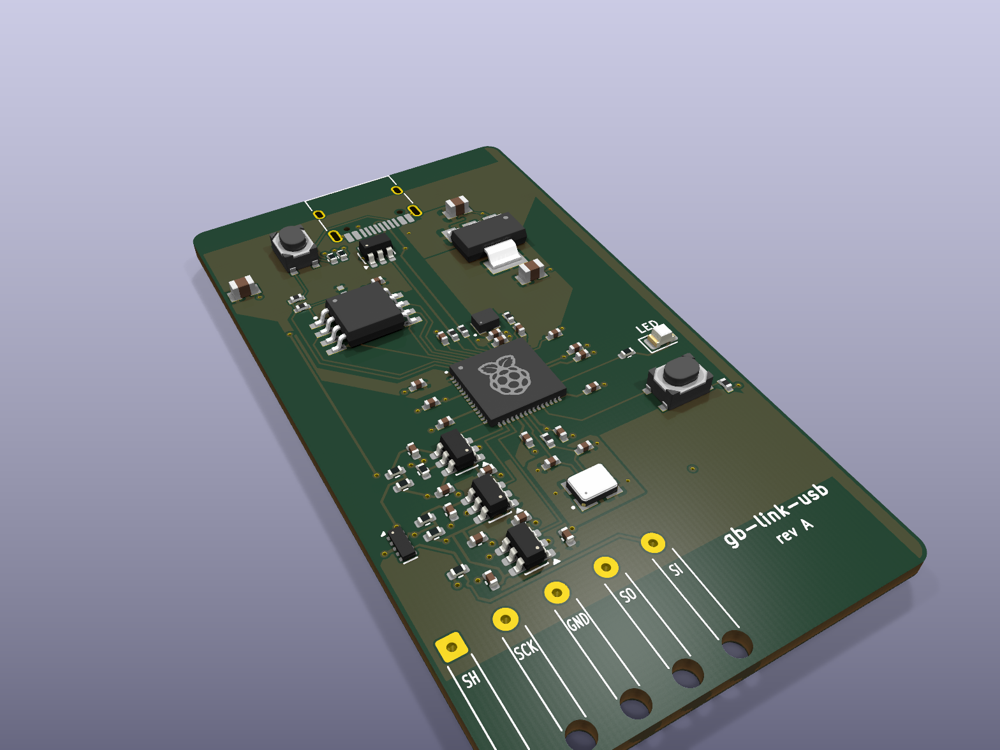
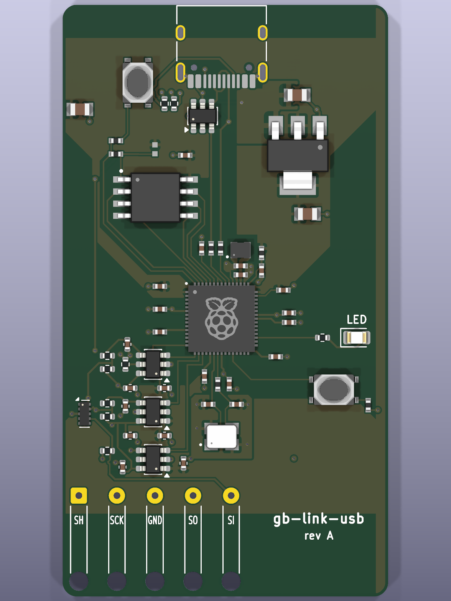
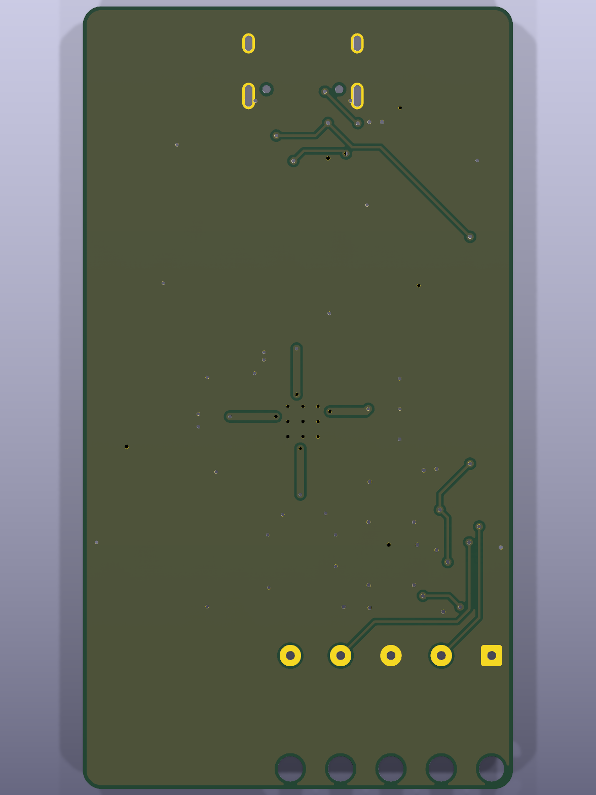
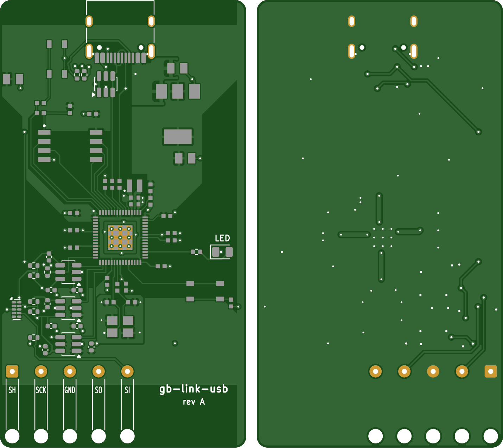

# Hardware: PCB rev A

A small USB-C dongle with the Game Boy link cable soldered on. RP2350A core from Raspberry Pi's minimal design, three 74LVC1T45 translators running the Game Boy side at USB 5 V (safe in any power order), ESD on USB and on the link lines. 34.25 x 62.25 mm, 2 layers, all parts on top, assembled by JLC. Spec and part choice: [`docs/PCB.md`](../docs/PCB.md). **Not ordered yet:** see [`rev-a/fab/ORDER.md`](rev-a/fab/ORDER.md).

<p>
  
</p>
<p>
  
  
</p>

Gerbers as the fab sees them (rendered independently with tracespace, top and bottom):



## Files
- `rev-a/`: KiCad 10 project. `link.json` is the source of the Link sheet (USB-C, buffers, ESD, cable pads, LED); the root sheet is Raspberry Pi's minimal design, edited by script.
- `rev-a/fab/`: order files (Gerbers zip, BOM, CPL) and the check reports.
- `case/`: 3D-printable case (OpenSCAD).
- `reference/RPI-RP2350A-MINIMAL_R4-S1_public/`: Raspberry Pi RP2350A minimal design (MIT, see its LICENSE.txt), the base for our board.
- `../sim/link/`: ngspice simulation of the link lines (why the series resistors are 220R with 100 pF).

## Rebuild everything (scripted, from the untouched RPi design)
KPY = KiCad's Python (`/Applications/KiCad/KiCad.app/Contents/Frameworks/Python.framework/Versions/Current/bin/python3`).
```sh
$KPY hw/tools/add_sheet.py          # schematic: root from RPi's design + Link sheet from link.json
$KPY hw/tools/extract_libs.py       # RPi symbols/footprints into project libraries
$KPY hw/tools/pcb_build.py          # board: RPi layout, new outline, our parts placed
$KPY hw/tools/pcb_route.py hand     # hand routes (GPIO fan, DIR lines)
$KPY hw/tools/pcb_gnd.py            # a GND via for every new GND pad
$KPY hw/tools/pcb_route.py 60       # Freerouting (retries until DRC is clean) + tidy-up + zone fill
hw/tools/make_fab.sh                # Gerbers, drill, BOM + check, CPL + check, pin audit
```

## Checks (all scripted, results 2026-10-16)
| check | tool | result |
|---|---|---|
| ERC | kicad-cli | same as Raspberry Pi's untouched design (2 off-grid, 1 power pin pair, 2 regulator pins) |
| DRC + schematic parity | kicad-cli | 0 errors, 0 warnings, 0 unconnected, parity 0 |
| Routing tidy-up | `route_audit.py` / `route_clean.py` | no stubs, sharp angles, pointless vias or detours; a few sub-0.05 mm pad-entry jogs left (most in RPi's own routing, kept as drawn) |
| Part heights | `height_check.py` | tallest: USB-C 3.25 mm, buttons 2.5 mm (feeds the case) |
| Link signals | `sim/link/run_sim.py` | 0 of 72 runs over a limit or glitching with 220R + 100 pF |
| BOM vs JLC | `make_bom.py` | all parts exist, match footprint and value; 1 stock FAIL: L1 inductor (hold point) |
| Placement | `make_cpl.py` | all 57 parts matched pad by pad against JLC's footprints |
| Pins | `pin_audit.py` | every pin vs JLC's symbol; caught the LED's reversed pad numbering (fixed in the CPL) |
| Gerbers | tracespace | render above |
