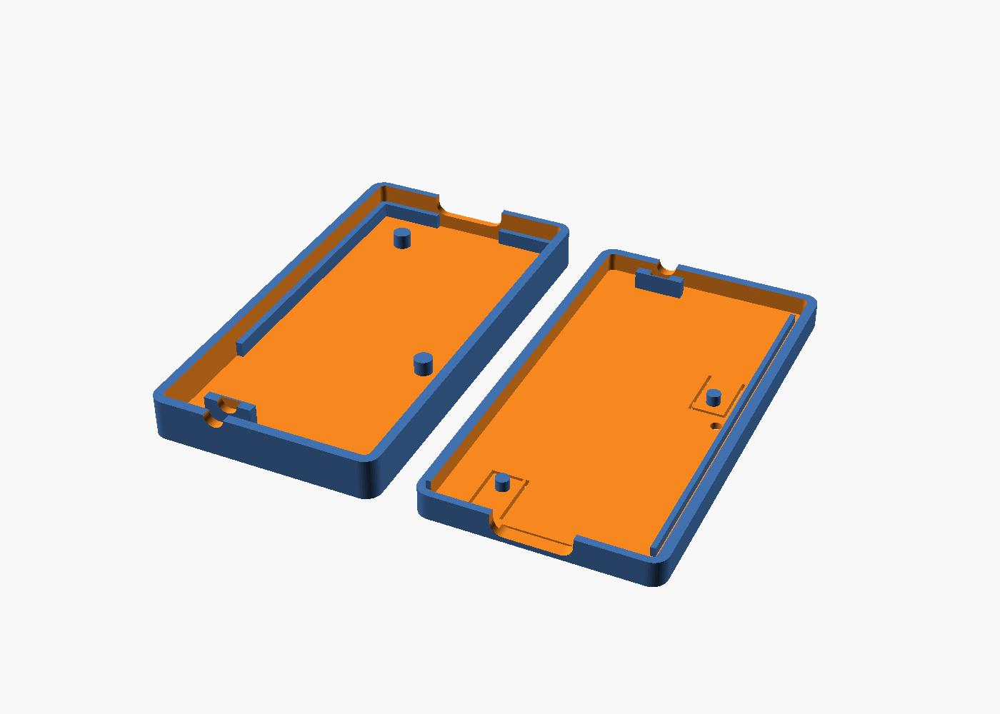
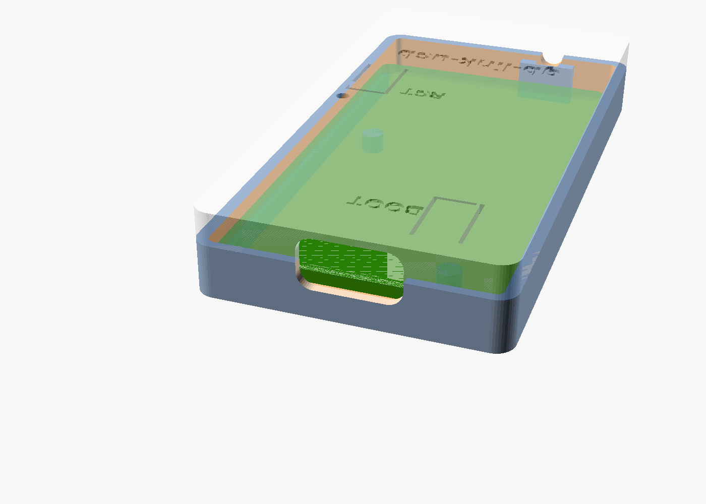

# Case for PCB rev A

Two printed parts, a **tray** and a **lid**, 38.0 x 72.5 x 11.1 mm outside. Source: `case.scad` (OpenSCAD).

  
  

- The board sits on a ledge under its long edges and is held down by a lip on the lid (on the outer 0.65 mm of the board; the nearest part is 0.81 mm in). The lid presses into the tray (0.15 mm clearance; change `FIT` for your printer, add a drop of glue if loose).
- USB-C opening 12.6 x 6.6 mm in the end wall (fits common plug overmolds, verify with your cable).
- The link cable's jacket is pinched between the tray and the lid, in the end wall and in an inner rib (0.3 mm squeeze per side). **Set `CABLE_D` to your cable's diameter before printing** (default 4.0 mm, verify).
- BOOTSEL and RUN: flex tabs in the lid with a nub over each button (labelled BOOT and RST). The LED shows through a 1.8 mm hole.
- Floor posts under both buttons, so pressing them does not bend the board.

## Print
`openscad -D 'part="tray"' -o tray.stl case.scad` and `-D 'part="lid"'` (the lid is exported roof down). STLs in this folder. PLA or PETG, 0.2 mm layers, no supports.

## Assembly
Solder the cable to the board first (wires up through the strain-relief holes, into the pads SH/SCK/GND/SO/SI; colours in LOGBOOK 2026-10-15). Lay the board in the tray, cable jacket in the notch, press the lid on.

## Checks
- `heights.json`: part heights from `hw/tools/height_check.py` (tallest USB-C 3.25 mm; 4.6 mm space above the board).
- `check_fit.py` (KiCad's Python): every top part as a box (courtyard x height) plus the board, intersected with tray and lid: **0.0 mm3 collision** (2026-10-16). Mutation test: with the lid 1.6 mm lower the check fails (23.8 mm3), so it can catch a collision.
- Not checked yet: an actual print (fit, flex tabs, cable grip).
